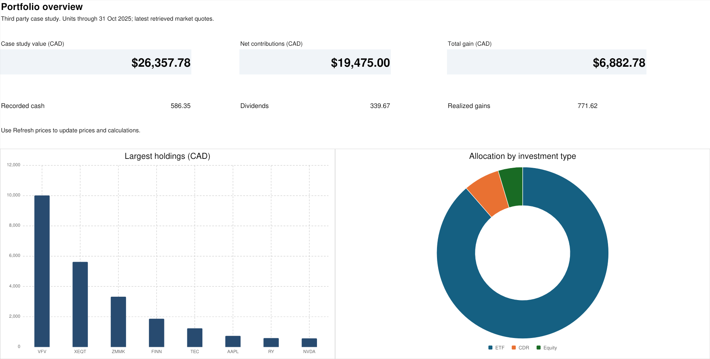

# Investment Portfolio Tracker

This project tracks an example investment portfolio in Excel. Python cleans the transaction files and gets share prices. VBA adds buttons for entering trades and updating the workbook.

The records come from a third party account. They are used as an example and are not personal investment records.



## Open this first

Open **Portfolio_Dashboard.xlsx** to see the portfolio.

The workbook already contains the recorded transactions, prices and calculations. To use the buttons, follow [the button guide](docs/VBA_GUIDE.md). Keep the workbook and its folders together.

## What it shows

1. Investments still held in the records.
2. The amount paid and the value using the saved share prices.
3. Gains and losses from sales and investments still held.
4. Contributions, dividends and cash.
5. Investment weights and monthly activity.

All totals are in Canadian dollars. Prices shown in US dollars are converted before they are added to the totals.

## What the folders are for

| Folder | What is inside |
|---|---|
| `raw` | Original statement CSV files |
| `data` | Clean transactions, prices and records of changes |
| `python` | Code for preparing data, getting prices and checking results |
| `vba` | Code for the Excel buttons |
| `docs` | Instructions, calculation notes and pictures |

You do not need to open every file to use the workbook.

## Using the buttons

The buttons need Windows desktop Excel and Python 3.10 or later. Python does not need any extra packages.

1. Save a copy of the workbook as `.xlsm` in the project folder.
2. Open Developer, then Visual Basic.
3. Choose File, then Import File. Select `vba/PortfolioAutomation.bas`.
4. Return to Excel. Open Developer, then Macros.
5. Run `InstallButtons` and save.
6. Open Add Transaction to use the six buttons.

If the buttons are already in your current workbook, replacing an older code module is explained in [the guide](docs/VBA_GUIDE.md).

## Reading the code

Start with `python/clean_transactions.py`. It reads the monthly CSVs and puts the entries into one file.

Next, read `python/refresh_prices.py`. It gets prices for investments still held and checks that each price belongs to the right listing.

The VBA file connects the buttons to the workbook. Its main routines have the same names as their buttons. Smaller helper functions handle repeated jobs, such as reading a date or adding a transaction row.

The test files check the results. They are separate from the code used for normal updates.

## Running Python yourself

Open a terminal in the project folder and run:

```sh
python python/clean_transactions.py
python python/refresh_prices.py
```

The first command prepares the transaction files. The second gets prices. These commands do not change the Excel workbook by themselves. The VBA buttons import the results into Excel.

To run the checks:

```sh
python python/test_pipeline.py
python python/test_prices.py
python python/validate_workbook.py
```

The last check uses the supplied workbook before any test transactions are added.

## Data notes

There are 269 entries from 16 different monthly statements. A second copy of one November statement was left out.

The NVIDIA records needed a correction for a CDR split. The reason and the source are explained in [how the calculations work](docs/METHODOLOGY.md).

Prices come from Yahoo Finance. They may be delayed, and the connection can change or stop working. The code keeps the actual price dates and any errors in the data files. A missing price is not treated as zero.

The workbook applies these prices to the units recorded through October 2025. It does not show what the account actually holds today.

## Checks completed

The clean data, duplicate file handling, price checks and workbook calculations have been tested. The original data and Excel results were kept the same after the code was rewritten.

The VBA still needs a test in desktop Excel. Follow the small test in [the button guide](docs/VBA_GUIDE.md). See [the full check results](docs/TEST_RESULTS.md) for details.
