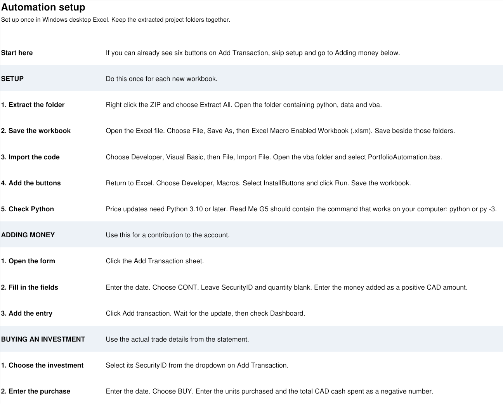

# How to use the buttons

If you already see six buttons on Add Transaction, your buttons are installed. Go to Adding money below.

## Set up a new workbook

Do these steps once for each new workbook.

1. Right click the ZIP and choose Extract All.
2. Open the folder containing the workbook, python, data and vba.
3. Open the workbook in desktop Excel.
4. Choose File, then Save As. Select the Excel file type ending in .xlsm. Save it in the same folder.
5. Choose Developer, then Visual Basic.
6. In that window, choose File, then Import File.
7. Open the vba folder. Select PortfolioAutomation.bas and click Open.
8. Return to Excel. Choose Developer, then Macros.
9. Select InstallButtons and click Run.
10. Open Add Transaction. You should see six buttons. Save the workbook.

Price updates also need Python 3.10 or later. No extra Python packages are needed. Read Me G5 contains the Python command. The usual command is python. If your computer uses py -3, enter that instead.

Keep the workbook beside the python and data folders. Moving only the workbook will stop price updates.

## If you already installed older code

Keep a backup of your current workbook first.

1. Open your working .xlsm file.
2. Choose Developer, then Visual Basic.
3. In the left panel, find your workbook and open Modules.
4. Right click PortfolioAutomation and choose Remove PortfolioAutomation. You can save a copy of the old code when asked.
5. Choose File, then Import File. Select the new PortfolioAutomation.bas from the vba folder.
6. Return to Excel and run InstallButtons again.
7. Save the workbook.

This replaces the code without deleting your transaction records. The button names are the same.

## Adding money

1. Open Add Transaction.
2. Enter the date.
3. Choose CONT in the Type field.
4. Leave SecurityID and quantity blank.
5. Enter the money added as a positive CAD amount.
6. Click Add transaction.
7. Wait for the update, then open Dashboard.

## Buying an investment

1. Open Add Transaction.
2. Choose the investment from the SecurityID dropdown.
3. Enter the trade date.
4. Choose BUY.
5. Enter the number of units bought.
6. Enter the total CAD cash spent as a negative number.
7. Click Add transaction and wait for the update.

For example, buying two units for CAD 90 in total means quantity 2 and cash -90.

Use the amount from the trade confirmation. Today's displayed share price is not the price of an earlier purchase.

## Selling an investment

1. Open Add Transaction.
2. Choose the investment and enter the sale date.
3. Choose SELL.
4. Enter the number of units sold.
5. Enter the net CAD cash received as a positive number.
6. Click Add transaction.

If you sell every unit, the investment leaves the open holdings table. If you sell some units, the rest stay in the table. The purchase history and gain or loss remain recorded. Do not delete the old purchases.

## Adding a new investment

1. Click Add security.
2. Enter an ID that identifies the listing. Use different IDs for different versions of an investment.
3. Enter its ticker, name, exchange and currency.
4. Enter its provider symbol. Examples are XEQT.TO, FINN.NE and UPS.
5. Enter a short part of its name for the price check, such as Vanguard or Apple.
6. Choose Equity, ETF or CDR when asked.
7. Return to Add Transaction and enter its first purchase.

A new investment starts with zero units. It appears on Dashboard after a purchase is recorded. NVDA and NVDA.TO are different listings, so do not swap their symbols.

## Recording a dividend

1. Choose the investment and date.
2. Choose DIV.
3. Leave quantity blank.
4. Enter the CAD dividend as a positive amount.
5. Click Add transaction.

For a reinvested dividend, record the dividend first. Then enter a separate BUY for the units purchased.

## Updating share prices

1. Click Refresh prices.
2. Wait for Python to finish.
3. Read the message. It tells you how many prices were updated.
4. Return to Dashboard.

Recalculate / charts uses the prices already stored. It does not download new prices.

## Try a small test

Use a separate test copy. Leave the original dataset unchanged.

1. Save a copy called Portfolio_Test.xlsm in the same folder.
2. Open Add Transaction.
3. Enter date 2025-11-01.
4. Choose CONT and enter cash 100.
5. Leave the investment and quantity blank.
6. Click Add transaction.

Contributions should change from CAD 19,475 to CAD 19,575. Recorded cash should change from CAD 586.35 to CAD 686.35. At unchanged quotes, value rises by CAD 100 and gain stays the same.

Discard the test copy afterwards.

## If a button stops

| Message or problem | What to do |
|---|---|
| Python was not found | Check that Python is installed. Check the command in Read Me G5. |
| Script was not found | Put the workbook beside the python folder. |
| Investment was not found | Use Add security before entering its purchase. |
| Sale exceeds available units | Check the quantity and any missing earlier purchases. |
| Backdated entry | The entry is older than the last record. Put the history in the correct order in a backup before continuing. |
| Price check failed | Check the provider symbol, name and currency in Securities. Read data/prices_latest.csv for the exact error. |

The Python scripts and workbook calculations have been checked. The VBA still needs a test in desktop Excel. The small contribution test above is the first check to run.
